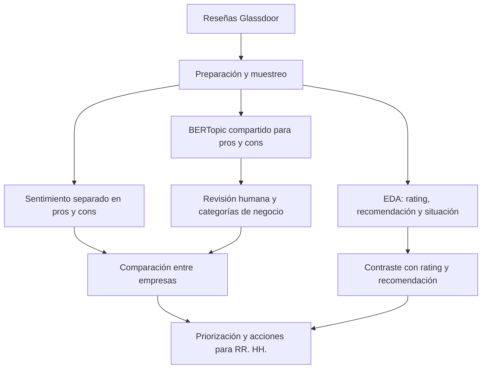

# Consulting & IT Employer Reputation Intelligence

> Análisis de reputación empleadora con NLP sobre reseñas de Glassdoor


## Problema de negocio

Las reseñas públicas contienen señales sobre la experiencia de empleados actuales y antiguos, pero están escritas en texto libre y no son directamente comparables. El proyecto organiza esas señales para ayudar a RR. HH. a detectar fortalezas, áreas de atención y diferencias frente a empresas que compiten por talento similar. Las reseñas son autoseleccionadas y no representan por sí solas a toda la plantilla.

## Objetivo

- Identificar fortalezas de Accenture como empleadora.
- Detectar áreas de mejora en pros y cons.
- Comparar la reputación con empresas del mismo mercado de talento.
- Explorar diferencias entre reseñas de empleados actuales y antiguos sin atribuirles motivos de salida.
- Traducir los hallazgos en hipótesis de trabajo para RR. HH.

## Empresas analizadas

Empresa focal: **Accenture**.

Peers: **Capgemini, Deloitte, Cognizant Technology Solutions e Infosys**. Se eligieron porque compiten por perfiles de consultoría, tecnología, servicios digitales y transformación empresarial, con operaciones internacionales y modelos de prestación de servicios comparables. La comparación es de reputación en Glassdoor, no de tamaño de plantilla ni de equivalencia exacta de negocio.

## Datos

- Fuente: archivo local `data/raw/glassdoor_reviews_hr.parquet` con reseñas de Glassdoor.
- Ventana solicitada: julio de 2018 a julio de 2023. El archivo disponible contiene reseñas del 27 de julio de 2018 al 18 de abril de 2023.
- Muestra analizada: 5.000 reseñas, hasta 1.000 por empresa, seleccionadas con semilla 42.
- Variables principales: empresa, fecha, rating general, recomendación, situación laboral, pros y cons.
- Los datos originales y el enunciado del caso se mantienen locales y no se redistribuyen con este repositorio.

## Metodología



El sentimiento se calcula con `distilbert-base-uncased-finetuned-sst-2-english`, un clasificador binario positivo/negativo. Los tópicos se modelan por separado para pros y cons con BERTopic, embeddings de `all-MiniLM-L6-v2`, UMAP y HDBSCAN. Después se revisan términos y reseñas representativas y se asignan manualmente categorías de negocio. El balance neto se define como `% de pros − % de cons`; la desventaja relativa de la matriz se define como `balance medio de peers − balance de Accenture`.

## Hallazgos principales

### Fortalezas

- Accenture obtiene el rating medio más alto de la muestra: **4,00/5**.
- El balance propio de entorno, equipo e instalaciones es **+10,40 puntos porcentuales**.
- El balance de compensación es negativo en Accenture (**−4,53 pp**), pero relativamente más favorable que la media de peers (**+13,65 pp** de brecha relativa).

### Áreas de mejora

- Carrera, crecimiento y aprendizaje presenta una brecha de **−4,52 pp** frente a peers. Las reseñas asignadas a esta categoría tienen rating medio **3,75** y recomendación **47,19%**, frente a **4,02** y **56,99%** en las demás reseñas de Accenture.
- Proyectos, clientes y asignación representa **11,12%** de los cons, con balance propio de **−5,32 pp** y brecha relativa de **−2,55 pp** frente a peers. Las reseñas asignadas a esta categoría no presentan menor rating ni recomendación que el resto, así que la hipótesis de fricción por carga o rotación debe comprobarse por subgrupo.
- Cultura, liderazgo y gestión tiene rating medio **3,57** y recomendación **48,08%** entre las reseñas asignadas. Su balance relativo frente a peers es favorable (**+2,50 pp**), pero en las reseñas de antiguos aparece **6,85 pp** más que en las de actuales y **3,48 pp** más que entre antiguos de los peers.

### Accenture frente a peers

- Capgemini supera a Accenture en recomendación: **57,7% frente a 56,2%**, aunque su rating medio es inferior.
- La brecha de compensación favorece relativamente a Accenture, mientras que carrera y proyectos/asignación presentan brechas negativas.
- El rating de empleados antiguos es inferior al de actuales en las cinco empresas. Las diferencias describen reseñas autoseleccionadas y no identifican causas.

## Resultados


## Recomendaciones para RR. HH.

1. **Carrera, crecimiento y aprendizaje:** revisar itinerarios de desarrollo y mecanismos de promoción interna; alinear expectativas de crecimiento y movilidad entre managers y empleados; comunicar una trayectoria profesional clara desde el onboarding y en las evaluaciones.
2. **Proyectos, clientes y asignación:** auditar la asignación de proyectos para investigar sobrecarga o rotación; introducir feedback sobre proyectos y clientes; y revisar la coherencia entre expectativas del cliente y recursos del equipo. La categoría muestra balance y brecha negativos, aunque el rating y la recomendación de esas reseñas no son peores que los del resto, por lo que carga y rotación son hipótesis a validar.
3. **Cultura, liderazgo y gestión:** evaluar la consistencia del liderazgo entre team leads, managers y dirección; reforzar programas de liderazgo y comunicación interna; y analizar las señales en reseñas de antiguos junto con entrevistas de salida. La diferencia temática no demuestra por sí sola motivos de salida.

## Tecnologías

Python, pandas, scikit-learn, Transformers, DistilBERT, Sentence Transformers, BERTopic, UMAP, HDBSCAN, Matplotlib y Jupyter.

## Estructura del repositorio

```text
.
├── data/raw/                         # Datos originales locales, excluidos de Git
├── docs/                             # Material del caso, local
├── notebooks/
│   ├── consulting-it-employer-reputation-intelligence.ipynb
│   └── clean_run_executed.ipynb      # Ejecución completa desde kernel limpio
├── output/                           # Tablas y figuras generadas localmente
├── scripts/                          # Scripts reproducibles
├── src/                              # Código fuente del proyecto
├── requirements.txt
├── requirements-lock.txt
└── README.md
```

## Cómo ejecutar

Desde la raíz del proyecto, en Windows PowerShell:

```powershell
python -m venv .venv
.\.venv\Scripts\Activate.ps1
python -m pip install --upgrade pip
python -m pip install -r requirements-lock.txt
jupyter notebook notebooks\consulting-it-employer-reputation-intelligence.ipynb
```

Para instalar dependencias con rangos de versiones más flexibles, usar `requirements.txt` en lugar de `requirements-lock.txt`. El archivo de datos debe estar disponible localmente en `data/raw/glassdoor_reviews_hr.parquet`. El modelo de embeddings se descarga de Hugging Face en la primera ejecución.

## Limitaciones

- Las reseñas son voluntarias y autoseleccionadas; no constituyen una muestra representativa de las plantillas.
- La selección equilibrada facilita comparar empresas, pero no representa su volumen real de opiniones ni su tamaño.
- La ventana observada termina el 18 de abril de 2023.
- El modelo de sentimiento es binario, en inglés y no tiene clase neutral; sus porcentajes son un control orientativo, no una medida de precisión.
- Las categorías de negocio se asignan manualmente y deben revisarse si se vuelve a entrenar BERTopic, porque los IDs de tópico pueden cambiar.
- Entre el 20% y el 27% de los textos queda sin tópico según empresa y campo. Los resultados son descriptivos y no demuestran causalidad ni significación estadística.

## Referencias

- Dataset de reseñas de Glassdoor proporcionado localmente para el caso práctico; no incluido en el repositorio público.
- [Modelo de sentimiento DistilBERT SST-2](https://huggingface.co/distilbert-base-uncased-finetuned-sst-2-english).
- [Sentence Transformer all-MiniLM-L6-v2](https://huggingface.co/sentence-transformers/all-MiniLM-L6-v2).
- [Documentación de BERTopic](https://maartengr.github.io/BERTopic/).
