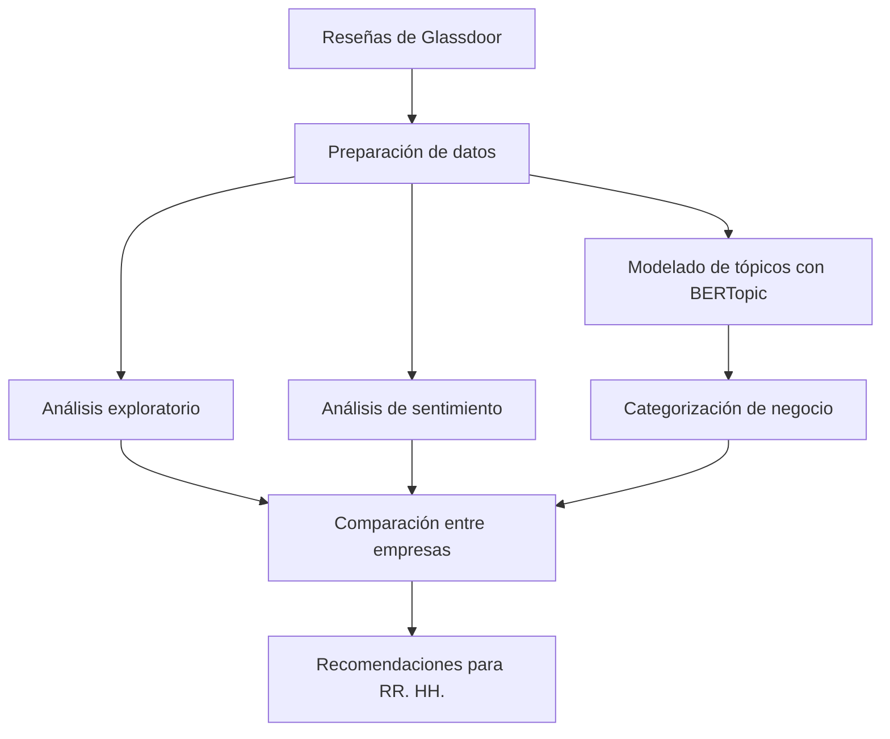
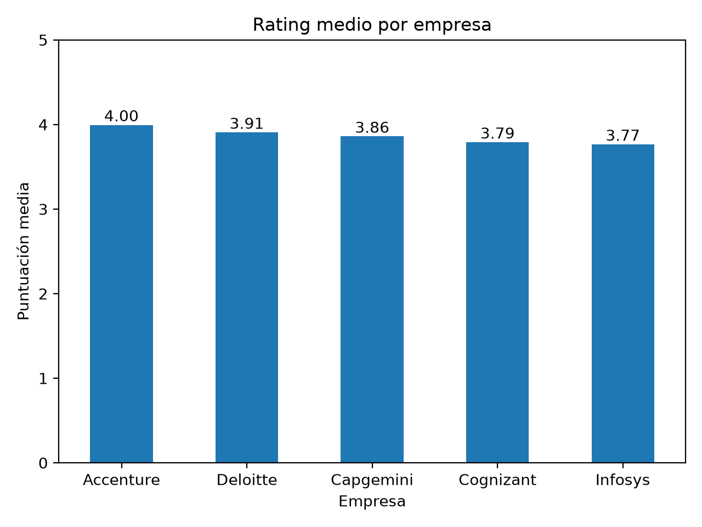
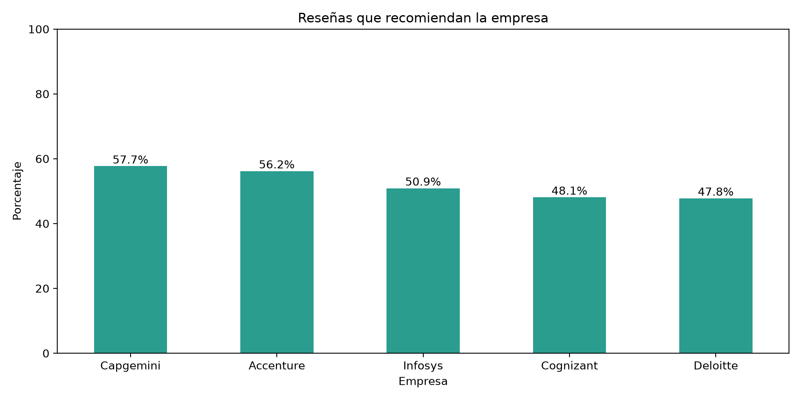
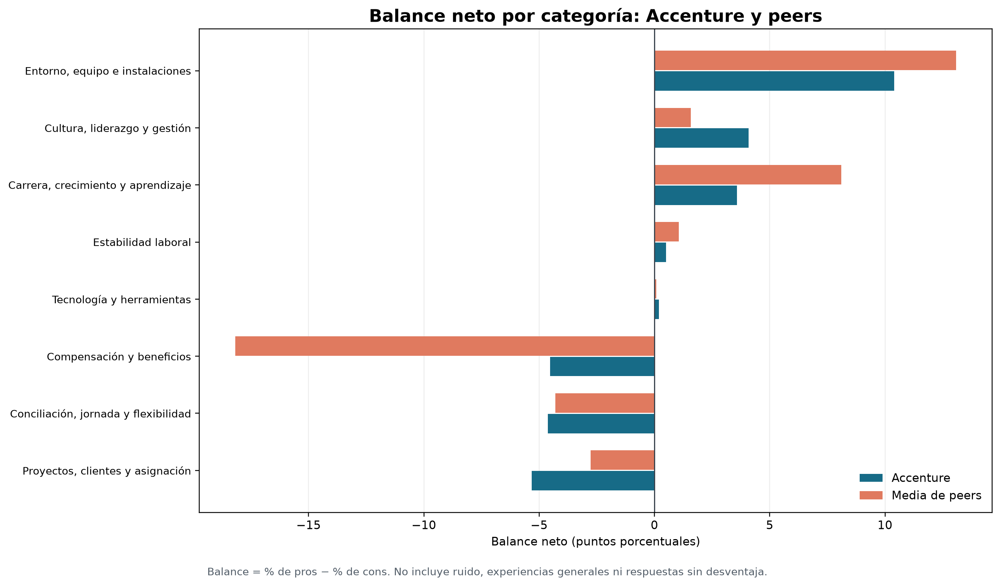
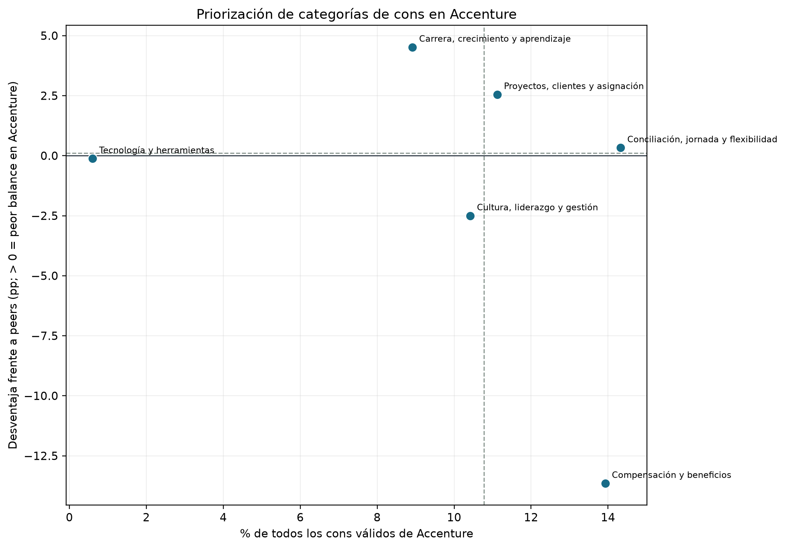

# Consulting & IT Employer Reputation Intelligence

> Análisis de reputación empleadora mediante NLP aplicado a reseñas de Glassdoor.

[](https://www.python.org/)
[](https://jupyter.org/)

## Problema de negocio

Las reseñas públicas de empleo contienen señales sobre la experiencia de empleados actuales y antiguos, pero están escritas en texto libre y no son directamente comparables. Este proyecto estructura esas señales para que RR. HH. pueda reconocer fortalezas, detectar áreas de atención y comparar la reputación de Accenture con la de empresas que compiten por talento similar.

El análisis describe las reseñas disponibles; no representa necesariamente a toda la plantilla ni permite determinar por qué una persona deja una empresa.

## Objetivo

El análisis busca:

- Identificar fortalezas de Accenture como empleadora.
- Detectar áreas de mejora en la experiencia de los empleados.
- Comparar la reputación de Accenture con la de empresas similares.
- Explorar diferencias entre reseñas de empleados actuales y antiguos como posibles señales que convenga investigar, sin atribuirles causas.
- Traducir los hallazgos en líneas de actuación para RR. HH.

## Empresas analizadas

La empresa focal es **Accenture**. La comparación incluye:

- Capgemini
- Deloitte
- Cognizant Technology Solutions
- Infosys

Se seleccionaron estos peers porque compiten por perfiles de consultoría, tecnología, servicios digitales y transformación empresarial, y tienen modelos de prestación de servicios y operaciones internacionales comparables. La comparación mide reputación en Glassdoor, no tamaño de plantilla ni equivalencia exacta de negocio.

## Datos

- **Fuente:** reseñas de Glassdoor proporcionadas localmente para el caso práctico. El archivo original no se incluye en el repositorio público.
- **Periodo solicitado:** julio de 2018 a julio de 2023.
- **Periodo disponible en el archivo:** del 27 de julio de 2018 al 18 de abril de 2023.
- **Muestra analizada:** 5.000 reseñas, hasta 1.000 por empresa, seleccionadas con semilla 42.
- **Empresas:** cinco, incluida Accenture.
- **Variables principales:** empresa, fecha, rating general, recomendación, situación laboral, pros y cons.
- **Limitaciones:** las reseñas son voluntarias y autoseleccionadas; el muestreo equilibrado facilita la comparación, pero no refleja el volumen real de reseñas ni el tamaño de las empresas.

## Metodología



El sentimiento se estima por separado para pros y cons con `distilbert-base-uncased-finetuned-sst-2-english`, un clasificador binario positivo/negativo. Los tópicos de pros y cons se modelan con BERTopic, embeddings de `all-MiniLM-L6-v2`, UMAP y HDBSCAN. Después se revisan términos y reseñas representativas para asignar manualmente categorías de negocio.

El balance neto se define como `% de pros − % de cons`. La brecha frente a peers se define como `balance medio de peers − balance de Accenture`; por tanto, una brecha negativa indica que el balance de Accenture es inferior al de sus peers.

## Hallazgos principales

### Fortalezas

- Accenture obtiene el rating medio más alto de la muestra: **4,00/5**.
- La categoría de entorno, equipo e instalaciones presenta un balance neto propio de **+10,40 puntos porcentuales**.
- Aunque el balance propio de compensación y beneficios es negativo (**−4,53 pp**), la brecha relativa favorece a Accenture frente a la media de peers (**+13,65 pp**).

### Áreas de mejora

- **Carrera, crecimiento y aprendizaje:** brecha de **−4,52 pp** frente a peers. Las reseñas de esta categoría tienen un rating medio de **3,75** y una recomendación del **47,19%**, frente a **4,02** y **56,99%** en las demás reseñas de Accenture.
- **Proyectos, clientes y asignación:** representa el **11,12%** de los cons y tiene un balance propio de **−5,32 pp** y una brecha de **−2,55 pp** frente a peers. El rating y la recomendación de estas reseñas no son inferiores a los del resto; la posible fricción por carga o rotación es una hipótesis que debe validarse.
- **Cultura, liderazgo y gestión:** las reseñas de esta categoría tienen un rating medio de **3,57** y una recomendación del **48,08%**. Aunque la brecha frente a peers es positiva (**+2,50 pp**), el rating y la recomendación apuntan a una oportunidad de mejora. La categoría aparece **6,85 pp** más en reseñas de antiguos empleados que en las de actuales y **3,48 pp** más que entre antiguos empleados de los peers; estas diferencias no demuestran motivos de salida.

### Accenture frente a peers

- Accenture registra el rating medio más alto (**4,00/5**), pero Capgemini tiene una recomendación más alta (**57,7% frente a 56,2%**).
- Las brechas de carrera y de proyectos, clientes y asignación son negativas; la brecha de compensación favorece relativamente a Accenture.
- El rating de empleados antiguos es inferior al de empleados actuales en las cinco empresas. La comparación es descriptiva y se refiere a reseñas autoseleccionadas.

## Resultados

Las siguientes gráficas están guardadas en el repositorio para que también se visualicen en GitHub.









## Recomendaciones para RR. HH.

### 1. Carrera, crecimiento y aprendizaje

**Acciones:**

- Revisar los itinerarios de desarrollo profesional y los mecanismos de promoción interna.
- Alinear las expectativas de managers y empleados sobre crecimiento y movilidad.
- Crear una narrativa clara de la trayectoria profesional en Accenture y comunicarla durante el onboarding y las evaluaciones.

**Motivo:** la brecha negativa (**−4,52 pp**) y la baja recomendación (**47,19%**) indican que las oportunidades de desarrollo se perciben con poca claridad o equidad.

### 2. Proyectos, clientes y asignación

**Acciones:**

- Auditar los procesos de asignación para detectar sobrecarga o rotación excesiva.
- Introducir mecanismos de feedback sobre la calidad de los proyectos y de los clientes.
- Revisar la coherencia entre las expectativas del cliente y los recursos disponibles para el equipo.

**Motivo:** la brecha (**−2,55 pp**) y el balance interno negativo (**−5,32 pp**) reflejan fricción durante la experiencia laboral activa, especialmente en carga y rotación. Como el rating y la recomendación de estas reseñas no son peores que los del resto, conviene validar estas hipótesis antes de atribuirles un impacto.

### 3. Cultura, liderazgo y gestión

**Acciones:**

- Evaluar la consistencia del liderazgo en distintos niveles: team leads, managers y dirección.
- Reforzar programas de liderazgo y comunicación interna centrados en la gestión de equipos y la coherencia cultural.
- Analizar las señales de salida asociadas a la mayor presencia de esta categoría en reseñas de antiguos empleados para entender qué aspectos del liderazgo se perciben peor tras dejar la empresa.

**Motivo:** aunque la brecha frente a peers es positiva (**+2,50 pp**), el rating (**3,57**) y la recomendación (**48,08%**) son bajos. Esto sugiere una percepción interna débil y una oportunidad de mejora en liderazgo; la diferencia entre reseñas actuales y antiguas no prueba por sí sola una causa de salida.

## Tecnologías

Python, pandas, scikit-learn, Transformers, DistilBERT, Sentence Transformers, BERTopic, UMAP, HDBSCAN, Matplotlib y Jupyter.

## Estructura del repositorio

```text
.
├── data/
│   └── raw/                         # Datos originales locales, no incluidos
├── docs/
│   └── images/                      # Gráficas incluidas en este README
├── notebooks/
│   ├── consulting-it-employer-reputation-intelligence.ipynb
│   └── clean_run_executed.ipynb
├── .gitignore
├── README.md
├── requirements-lock.txt
└── requirements.txt
```

## Cómo ejecutar

Desde la raíz del proyecto, en Windows PowerShell:

```powershell
python -m venv .venv
.\.venv\Scripts\Activate.ps1
python -m pip install --upgrade pip
python -m pip install -r requirements-lock.txt
jupyter notebook notebooks\consulting-it-employer-reputation-intelligence.ipynb
```

Para instalar dependencias con rangos de versiones más flexibles, se puede usar `requirements.txt` en lugar de `requirements-lock.txt`. La ejecución completa requiere disponer localmente del archivo `data/raw/glassdoor_reviews_hr.parquet`. El modelo de embeddings se descarga de Hugging Face en la primera ejecución.

## Limitaciones

- Las reseñas son voluntarias y autoseleccionadas, por lo que no constituyen una muestra representativa de las plantillas.
- La muestra equilibrada facilita la comparación entre empresas, pero no representa el volumen real de opiniones ni el tamaño de cada plantilla.
- El periodo observado termina el 18 de abril de 2023.
- El modelo de sentimiento es binario, está entrenado en inglés y no tiene una clase neutral; sus resultados son orientativos.
- Las categorías de negocio se asignan manualmente y deben revisarse si se vuelve a entrenar BERTopic, ya que los identificadores de tópico pueden cambiar.
- Entre el 20% y el 27% de los textos queda sin tópico según la empresa y el campo analizado.
- Los resultados son descriptivos: no demuestran causalidad ni significación estadística.

## Referencias

- Dataset de reseñas de Glassdoor proporcionado localmente para el caso práctico; no incluido en el repositorio público.
- [Modelo de sentimiento DistilBERT SST-2](https://huggingface.co/distilbert-base-uncased-finetuned-sst-2-english).
- [Sentence Transformer all-MiniLM-L6-v2](https://huggingface.co/sentence-transformers/all-MiniLM-L6-v2).
- [Documentación de BERTopic](https://maartengr.github.io/BERTopic/).
